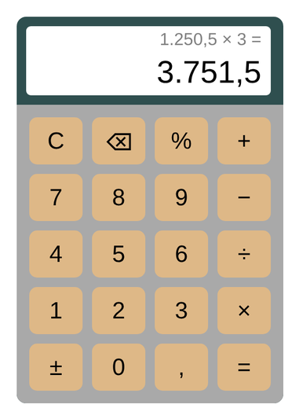

<div align="center">

# 🧮 Calculadora

**Calculadora web feita com HTML, CSS e JavaScript puro, sem nenhuma biblioteca.**

[**▶️ Testar online**](https://pedroaguirree.github.io/Calculadora/calculadora.html)




</div>

## Funcionalidades

- **As quatro operações**, respeitando a ordem matemática (`2 + 3 × 4 = 14`)
- **Números decimais** no padrão brasileiro, com vírgula e separador de milhar (`1.250,5`)
- **Prévia do resultado** enquanto você digita a conta
- **Porcentagem**, **troca de sinal (±)**, **apagar o último dígito (⌫)** e **limpar tudo (C)**
- **Continua a partir do resultado**: depois do `=`, é só apertar um operador
- **Trata erros**, como divisão por zero, sem quebrar a tela
- **Sem erros de arredondamento** do JavaScript (`0,1 + 0,2 = 0,3`, e não `0,30000000000000004`)
- **Suporte ao teclado**: números, `+` `-` `*` `/`, `Enter`, `Backspace` e `Esc`
- **Visual simples**, com botões acessíveis por leitor de tela

## Como funciona

A conta é guardada como uma lista de números e operadores, por exemplo `["12.5", "*", "-3", "+", "4"]`.

O cálculo é feito em duas passadas: primeiro resolve as multiplicações e divisões, depois as somas e subtrações. Assim, a ordem matemática é respeitada **sem usar `eval()`**, que seria inseguro e aceitaria qualquer código.

## Estrutura

```
├── calculadora.html   # Estrutura e botões
├── calculadora.css    # Visual
├── calculadora.js     # Lógica da conta, formatação e teclado
└── docs/preview.png   # Imagem do README
```

## Como rodar

Não precisa instalar nada: baixe o projeto e abra o `calculadora.html` no navegador.

```
git clone https://github.com/Pedroaguirree/Calculadora.git
```

## Histórico

A primeira versão foi feita em 2022, quando eu estava começando a programar. Em 2026, reescrevi o projeto: corrigi a subtração, a multiplicação e a divisão (antes só a soma funcionava), adicionei decimais e suporte ao teclado, mantendo o visual simples da versão original.

## Autor

Feito por **Pedro Aguirre**.
